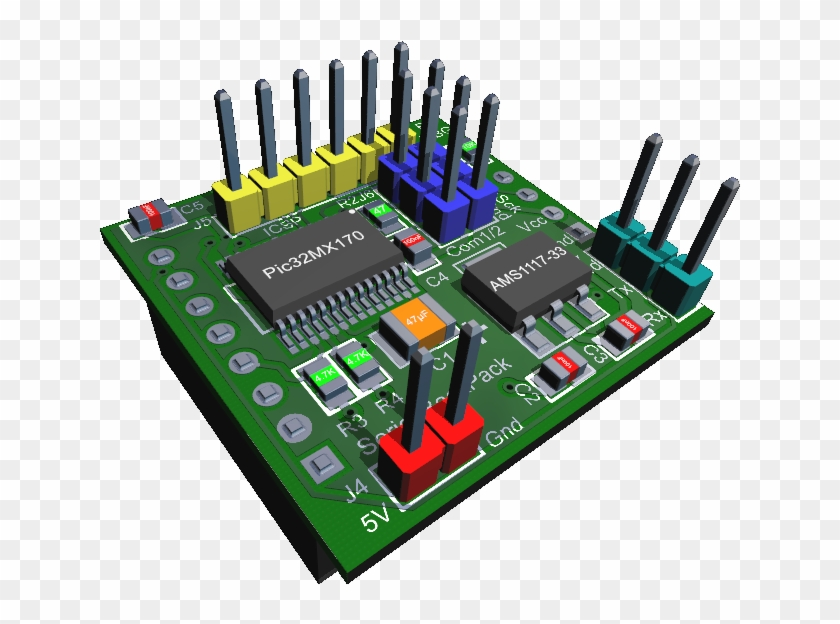

# Connect the programming fixture

1. Disconnect power from the DUT.
2. Align the keyed programming header with the connector shown below.
3. Press the connector firmly into place.
4. Restore power and verify that the status LED is green.

> **Important:** Never connect or remove the programming header while the DUT is powered.

Select **Ok** when the fixture is ready.